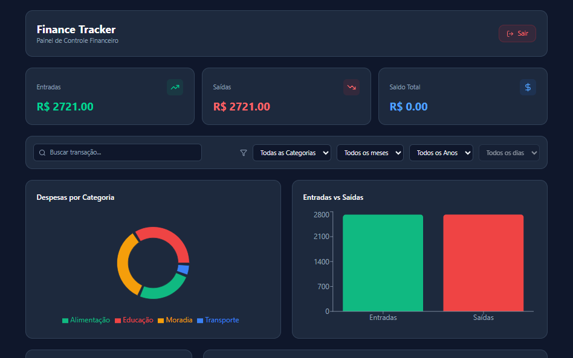

# Finance Tracker — Web

> Dashboard de finanças pessoais: resumo calculado no servidor, gráficos,
> filtros por período e exportação Excel. React 19 + TypeScript + Tailwind.

[](https://github.com/pedrimhp777-oss/finance-tracker-front/actions/workflows/ci.yml)

**🔗 Aplicação:** https://finance-tracker-front-pearl.vercel.app
**⚙️ API:** [finance-tracker](https://github.com/pedrimhp777-oss/finance-tracker)



---

## Sobre

Frontend de uma aplicação full-stack de finanças pessoais. O foco não foi
"montar telas", e sim construir uma camada de apresentação que **confia no
servidor para o que importa**: nenhum total é calculado no cliente, nenhum
filtro é aplicado em memória, e o gráfico reflete exatamente o que a API
respondeu.

## Stack

| Camada | Tecnologia |
|---|---|
| UI | React 19 + TypeScript |
| Build | Vite 8 |
| Estilo | Tailwind CSS 4 |
| HTTP | Axios (interceptors de auth e sessão expirada) |
| Gráficos | Recharts 3 (code-splitting) |
| Ícones / feedback | Lucide React · React Hot Toast |
| Testes | Vitest + Testing Library + jsdom |
| Lint | oxlint |
| Deploy | Vercel (com CSP e headers de segurança) |

## Estrutura

```
src/
├── pages/
│   ├── Auth.tsx               # Login, cadastro e acesso à recuperação
│   ├── Dashboard.tsx          # Painel: topbar, resumo, tabela, exportação
│   └── PasswordRecovery.tsx   # Solicitar link + criar nova senha
├── components/
│   ├── FinanceCharts.tsx      # Gráficos (lazy-loaded)
│   ├── FinanceFilters.tsx     # Busca, categoria, mês, ano, dia
│   └── TransactionForm.tsx    # Criar/editar transação
├── contexts/AuthContext.tsx   # Sessão, restauração e logout
├── hooks/useTransactions.ts   # Fonte única de dados do painel
├── services/api.ts            # Instância Axios + mensagens de erro
└── types/finance.ts           # Tipos compartilhados
```

## Funcionalidades

- **Autenticação** com toasts, estados de carregamento e restauração de sessão
- **Recuperação de senha**: solicitar link por e-mail e criar nova senha
- **Resumo financeiro** (entradas, saídas, saldo) — calculado pela API
- **Gráficos** de despesas por categoria e entradas vs saídas
- **Filtros no servidor**: busca, categoria, mês, **ano** (derivado do histórico)
  e **dia** (habilitado apenas com mês + ano definidos)
- **Paginação incremental** ("carregar mais")
- **Exportação Excel** refletindo exatamente os filtros ativos, com o fuso do
  navegador
- **Data opcional** por máscara `DD/MM/AAAA` + calendário nativo, com validação
  de data inválida e futura
- **Acessibilidade**: `label` associado a cada campo, `aria-label` nos controles
  sem rótulo visual, `aria-invalid` e mensagens de erro anunciáveis

## Como os dados fluem

```
FinanceFilters ──► filtros (estado no Dashboard)
                        │
                        ▼
              useTransactions(filtros)  ──► API (filtros + paginação no servidor)
                        │
        ┌───────────────┼───────────────┐
        ▼               ▼               ▼
   Histórico      Resumo/Gráficos   Exportação Excel
```

**Decisões que evitam divergência de estado:**

- **Fonte única de dados** — a lista, o resumo e os gráficos saem do mesmo hook;
  nada é recalculado no cliente, então não existe "saldo que não fecha".
- **O ano é derivado do histórico real** do usuário (menor ano encontrado), em
  vez de uma lista fixa de décadas. Sem filtro de ano, a API devolve os anos
  disponíveis.
- **O dia é limpo automaticamente** quando mês ou ano mudam — evita o estado
  inválido "dia 31 de fevereiro".
- **Datas em `datetime` com fuso**, não string: a conversão para exibição usa o
  fuso do navegador, então o mesmo registro não "muda de dia" em outra máquina.

## Segurança no deploy

O `vercel.json` aplica a política de segurança — sem isso, a Vercel entrega
apenas HSTS:

```
Content-Security-Policy: default-src 'self'; script-src 'self';
  style-src 'self' 'unsafe-inline'; img-src 'self' data:; font-src 'self';
  connect-src 'self' https://finance-tracker-api-7d8o.onrender.com;
  object-src 'none'; base-uri 'none'; form-action 'self'; frame-ancestors 'none'
X-Content-Type-Options: nosniff
X-Frame-Options: DENY
Referrer-Policy: no-referrer
Permissions-Policy: geolocation=(), microphone=(), camera=(), payment=(), usb=()
```

A política foi derivada dos recursos **reais** do bundle, não de suposição:

| Diretiva | Por quê |
|---|---|
| `script-src 'self'` | o HTML só referencia `/assets/*.js`; há 0 scripts inline e 0 `eval` |
| `style-src 'self' 'unsafe-inline'` | o Recharts aplica atributos `style` em tempo de execução |
| `connect-src` + API | única origem de rede que o app consome |

> `'unsafe-inline'` em `style-src` é inevitável em hospedagem estática (nonce
> exigiria SSR) e é a única flexibilização da política.
>
> Antes de ativar em modo *enforcing*, a política roda em `Report-Only` e é
> validada no console do navegador — nenhuma violação em login, gráficos,
> filtros, cadastro, exportação e logout.

## Testes

```bash
npm test            # 42 testes
npm run lint        # oxlint
npx tsc --noEmit    # tipos
```

| Arquivo | Cobre |
|---|---|
| `Auth.test.tsx` | login urlencoded, cadastro, erro da API |
| `AuthContext.test.tsx` | restauração de sessão, logout, evento de 401 |
| `TransactionForm.test.tsx` | máscara de data, validação, criação/edição |
| `FinanceFilters.test.tsx` | anos derivados, dia condicionado, limpeza de estado |
| `PasswordRecovery.test.tsx` | solicitar link, senhas divergentes, payload, limpeza do token |
| `useTransactions.test.tsx` | filtros, paginação, exportação |
| `getApiErrorMessage.test.ts` | extração de mensagem de erro do FastAPI |

## Rodando local

```bash
npm install
echo "VITE_API_URL=http://localhost:8000" > .env.local
npm run dev        # http://localhost:5173
```

Variáveis:

| Variável | Função |
|---|---|
| `VITE_API_URL` | base da API (padrão em produção: Render) |

> Ao rodar o frontend em `localhost`, a API precisa permitir essa origem
> (`FRONTEND_URL` + origens de dev no CORS do backend).

## Deploy

Vercel → build `npm run build` → saída `dist`. O `vercel.json` versionado aplica
CSP e os headers de segurança.

## Decisões e trade-offs

| Decisão | Motivo | Custo aceito |
|---|---|---|
| Agregações no servidor | uma fonte de verdade; nada de total divergente | depende de ida à API |
| Token em `localStorage` | Axios simples, sem cookie de terceira parte entre domínios distintos | exposto a XSS — mitigado por CSP e ausência de vetores |
| Gráficos com `lazy` | o bundle de Recharts (382 kB) não bloqueia o login | um chunk extra após o dashboard |
| Filtros com `useMemo` para anos | evita recomputar em cada render | — |
| Máscara de data manual | `<input type="date">` não permite digitar `DD/MM/AAAA` no formato brasileiro | ~60 linhas de máscara testadas |
| Logout *best-effort* | não bloqueia a saída se a rede falhar | a revogação pode não chegar; o token expira em 30 min |

## Limitações conhecidas

- Sessão em `localStorage` (migrar para cookie `HttpOnly` exige domínio compartilhado)
- Logout revoga **todas** as sessões do usuário — os outros dispositivos precisam entrar de novo
- A recuperação de senha depende de um provedor de e-mail verificado
